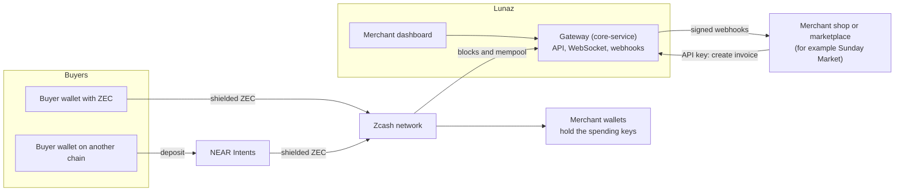

# Lunaz

Pay with anything. Settled in private.

Lunaz is a non-custodial payment gateway for shielded Zcash. A buyer pays with ZEC, or with USDC, USDT, SOL, ETH or BTC through NEAR Intents. The funds arrive as shielded ZEC in the merchant's own wallet. Lunaz holds incoming viewing keys only, so it can see incoming payments but cannot spend anything.

The name comes from the Indonesian word *lunas* ("paid in full") plus a "z" for Zcash. LUNAS is the success state that a buyer sees when a payment is complete.

- Website and dashboard: https://lunaz.alwaysbedream.dev
- Documentation: https://lunaz.alwaysbedream.dev/docs
- Demo marketplace (Sunday Market): https://demo.lunaz.alwaysbedream.dev

## The problem

On a transparent chain, every payment to a merchant is public. A competitor can read a shop's daily revenue, its suppliers and its regular customers from a block explorer. The buyer's whole balance and history are exposed to the shop as well.

Lunaz is built for three groups:

- Merchants and marketplaces that want to accept crypto and keep their business data private.
- Buyers who hold assets on other chains and do not want to buy ZEC first.
- Accountants, who still need a complete record. The merchant's viewing key and the CSV export provide it.

## Repositories

| Repository | What it is | Stack |
| --- | --- | --- |
| [core-service](https://github.com/Lunaz-Gateway/core-service) | The gateway: invoices, chain watcher, cross-chain swaps, webhooks, API and WebSocket | Rust, Axum, SQLite |
| [landing](https://github.com/Lunaz-Gateway/landing) | Website and the merchant dashboard | TanStack Start, React 19 |
| [sunday-market](https://github.com/Lunaz-Gateway/sunday-market) | Sunday Market, a demo marketplace with five shops on one gateway | TanStack Start, React 19, SQLite |
| [docs](https://github.com/Lunaz-Gateway/docs) | Documentation site | Astro, Starlight |

Each repository has its own README with setup and development notes. [ROADMAP.md](ROADMAP.md) shows what comes next.

## How it works

- A buyer with ZEC pays the invoice address on the Zcash network. A buyer with another asset deposits on the origin chain, and NEAR Intents delivers ZEC to the same invoice address.
- The gateway reads new blocks and the mempool, and finds payments with the merchant's incoming viewing key.
- The gateway tells the shop about each payment through a WebSocket and signed webhooks.
- The merchant uses the dashboard to connect a wallet, create API keys, set up webhooks, see invoices and export records.
- The spending keys stay in the merchant wallets, outside every Lunaz service.

## Key design points

- One address per invoice. Lunaz derives each invoice address from the merchant's unified incoming viewing key (UIVK) as a diversified Orchard address. An invoice address never matches an address that the merchant uses elsewhere, so addresses never link.
- Incoming key only. A merchant can connect a UIVK (`uivk1...`) or a full viewing key (`uview1...`). Lunaz keeps only the incoming part, so it never stores the key that shows outgoing payments.
- Fast detection. Lunaz watches the Orchard and Ironwood pools in new blocks and in the mempool. A payment shows as `detected` in seconds and as `paid` after one confirmation.
- Statuses. An invoice is `pending`, `detected`, `paid`, `underpaid` or `expired`. Payments to one address add up, so a buyer can pay the rest of an amount before the invoice expires.
- Cross-chain payments. The buyer pays the swap fees and a 0.75% app fee (the 0.5% Lunaz fee plus 0.25% for the swap). The merchant receives the full invoice amount. The minimum for a swap is approximately 0.001 ZEC.
- Signed webhooks. Each webhook has an `X-Lunaz-Signature` header with the HMAC-SHA256 of the body. Lunaz tries each event up to 3 times (at once, after 10 s and after 60 s). The merchant can send a failed event again from the dashboard.
- Accountant export. The dashboard exports invoices or payments as CSV, with the USD rate at the time of payment.
- Passwordless sign-in. Merchants sign in to the dashboard with their email and a one-time code.
- Multi-merchant. One marketplace can serve many merchants. Each seller has its own Lunaz account, viewing key, wallet and API key.
- Withdraw to bank. A merchant can convert ZEC to local currency, for example IDR, through a licensed off-ramp partner. The merchant sends ZEC from their own wallet to the partner. Lunaz keeps only the bank name and the last 4 digits of the account number. This feature is in testing.

## Payment flows

### Direct shielded ZEC

1. The shop creates an invoice through the API.
2. Lunaz returns a fresh shielded address and a ZIP-321 payment URI. The URI has two payments: the merchant's amount and the Lunaz fee.
3. The buyer scans the QR code with a Zcash wallet and pays.
4. Lunaz sees the transaction in the mempool. The status changes to `detected`.
5. The transaction is mined. The status changes to `paid`.
6. Lunaz sends the `invoice.paid` webhook to the shop.

If the invoice expires with a mined payment that is less than the amount, the status is `underpaid`.

### Cross-chain

1. The shop creates an invoice, as for a direct payment.
2. The buyer chooses an asset and gives a refund address on the origin chain.
3. Lunaz gets a quote from NEAR Intents and shows a one-time deposit address with the amount to send.
4. The buyer sends the asset to the deposit address.
5. NEAR Intents swaps the asset and sends shielded ZEC to the invoice address.
6. Lunaz sees the ZEC like any other payment. The status changes to `detected`, then `paid`.

If the swap is refunded or fails, the invoice stays `pending`. The buyer can choose another asset or pay with ZEC.

## Security and privacy

What Lunaz can do:

- See incoming payments to the invoice addresses of its merchants (amounts and transaction IDs).
- Create invoice addresses.

What Lunaz cannot do:

- Spend funds. It holds no spending key.
- See outgoing payments, spends or balances in the merchant wallets.

What is public:

- On chain, nothing links invoices to each other or to the merchant.
- In a cross-chain payment, the deposit on the origin chain is public. Only the shielded leg is private.
- A withdrawal to a bank is not private. The merchant sends ZEC to a transparent deposit address of the partner, and the partner knows the identity of the merchant.

## Pricing

Lunaz is a managed service. You pay only when you get paid. There are no monthly plans, no setup fee, no invoice limits and no API key limits.

| Payment | Lunaz fee | Who pays |
| --- | --- | --- |
| Shielded ZEC | 0.5% (minimum 1,000 zatoshis, 0.00001 ZEC) | The buyer, on top of the price |
| Cross-chain (NEAR Intents) | 0.75% app fee on the swap (the 0.5% Lunaz fee plus 0.25%) | The buyer, inside the deposit amount |

- The ZIP-321 payment request of an invoice (`zip321_uri`) has two payments in one shielded transaction. One goes to the merchant for the full amount. One goes to a Lunaz address for the fee. The fee output is shielded too.
- Lunaz never holds or touches the merchant's funds. The fee goes from the buyer to Lunaz in the same transaction.
- Lunaz takes no fee from the amount that the merchant receives.
- If a buyer's wallet pays only the merchant part, the invoice is still marked `paid`. Lunaz bills the missing fee to the merchant later.
- Enterprise: contact us for volume pricing.

## For integrators

The public API uses JSON and an API key in `Authorization: Bearer <key>`. Create the key in the dashboard.

| Endpoint | Purpose |
| --- | --- |
| `POST /v1/invoices` | Create an invoice (API key) |
| `GET /v1/invoices/{id}` | Read the status of an invoice |
| `GET /v1/invoices/{id}/ws` | Live status through a WebSocket |
| `GET /v1/swap/assets` | Assets that a buyer can pay with |
| `POST /v1/invoices/{id}/swap` | Start a cross-chain payment for an invoice |

Lunaz sends signed webhooks to your endpoint. The [documentation](https://lunaz.alwaysbedream.dev/docs) has the full API reference, webhook payloads and signature samples.

## Getting started for a merchant

You need a Zcash wallet that can export a unified incoming viewing key (UIVK) or a unified full viewing key (UFVK).

1. Open the Lunaz dashboard and sign in with your email and the one-time code.
2. Export the incoming viewing key (UIVK) from your wallet. If your wallet exports only a full viewing key (UFVK), use that.

   CAUTION: MAKE SURE THAT THE VIEWING KEY IS CORRECT BEFORE YOU SAVE IT. YOU CANNOT CHANGE IT AFTER YOU SET IT.

3. Paste the viewing key in the dashboard.
4. Create an API key, and copy it at once. The dashboard shows it one time only.
5. Set the URL of your webhook endpoint and copy the signing secret.
6. Send a test event from the dashboard. Make sure that your endpoint returns a 2xx status.
7. Create an invoice with `POST /v1/invoices`.
8. Show the `zip321_uri` as a QR code or link, or send the buyer to your checkout page. Always use the `zip321_uri` as it is. It has the Lunaz fee in it. If you build your own request from the address and amount, the fee is lost.
9. Wait for the `invoice.paid` webhook.

Keep your spending keys in your own wallet. Do not give them to Lunaz.

## Sunday Market

[Sunday Market](https://demo.lunaz.alwaysbedream.dev) shows how a marketplace uses Lunaz. It has five independent shops, and each shop is its own Lunaz merchant with its own wallet. The marketplace keeps its orders in its own database. It receives the Lunaz webhooks, checks the signature and marks orders as paid. Buyers can pay with shielded ZEC or with another asset.

## Known limitations

- Chain reorganisations are not handled yet.
- The viewing key cannot be changed after you set it.
- Wallet creation in the browser is not available yet. Merchants bring their own wallet and viewing key.
- Withdraw to bank is in testing with the off-ramp partner.
- Some wallets may not support payment requests with two recipients yet.
- A cross-chain payment needs an invoice of approximately 0.001 ZEC or more.
- A swap can deliver a little more or less ZEC than the invoice. Lunaz cannot refund. The merchant refunds any difference.
- The deposit on the origin chain of a cross-chain payment is public.
